<p align="center">
  
</p>

<p align="center">
  <a href="https://inbox.jackyzhonghq.com"><b>Website</b></a> &nbsp;·&nbsp;
  <a href="#what-you-get"><b>Features</b></a> &nbsp;·&nbsp;
  <a href="#how-your-data-stays-yours"><b>Privacy</b></a> &nbsp;·&nbsp;
  <a href="#install"><b>Install</b></a> &nbsp;·&nbsp;
  <a href="#built-with-ai"><b>Built with AI</b></a>
</p>

<p align="center">
  
  
  
  
  
</p>

J-Inbox puts WhatsApp, iMessage, Instagram, LinkedIn, X, Telegram, Signal, SMS and Gmail in one fast inbox. Your AI agents can read a chat when you ask, draft a reply or take on the task, but **nothing is sent until a person approves it**.

This repo is the open-source half: the connector that runs on your Mac, so you can check exactly what it does.

<p align="center">
  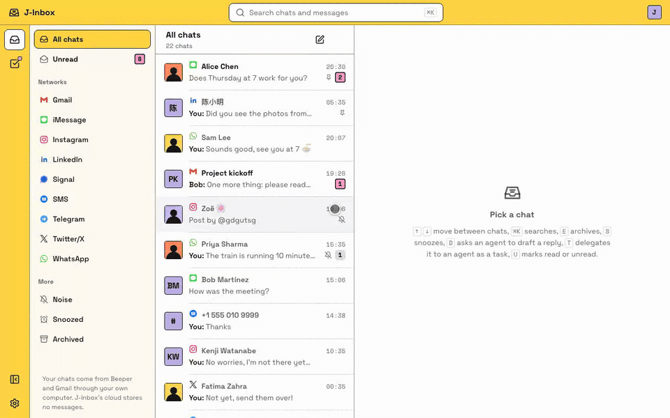
</p>
<p align="center"><sub>Every name and message in these images is invented demo data.</sub></p>

## What you get

### One inbox for everything

Every network in one list, with filters for each network, Unread, Noise, Snoozed and Archived. Each conversation still looks like its own app, so a WhatsApp chat reads like WhatsApp and a Gmail thread reads like Gmail.

<table>
  <tr>
    <td width="33%">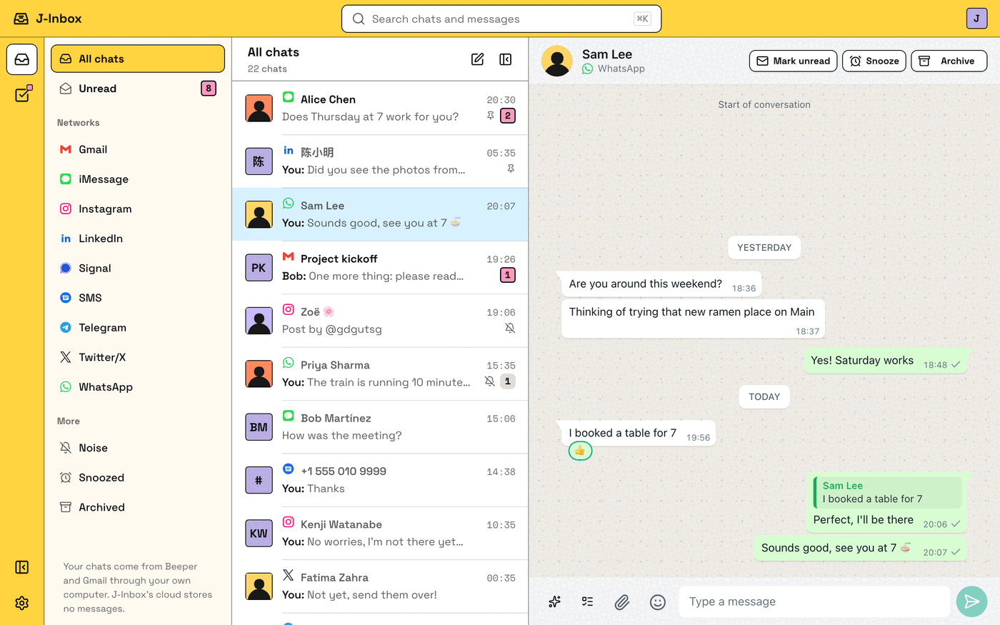<p align="center"><sub>WhatsApp</sub></p></td>
    <td width="33%">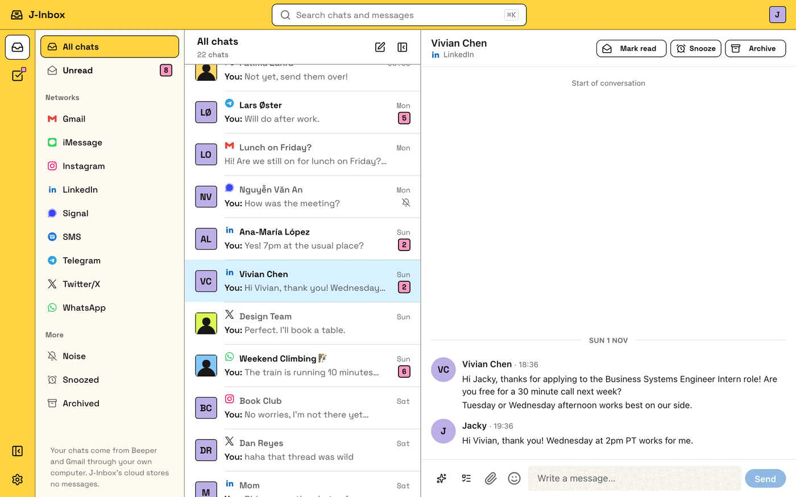<p align="center"><sub>LinkedIn</sub></p></td>
    <td width="33%">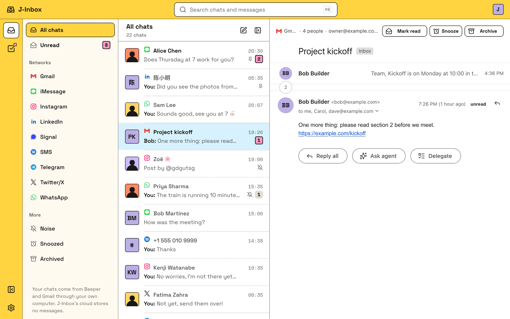<p align="center"><sub>Gmail</sub></p></td>
  </tr>
</table>

### Agents that help, and never send on their own

Press <kbd>D</kbd> in any chat and tell an agent what you want to say. Its draft comes back as a card you can **send, edit, rewrite or discard**. If an agent asks to send something itself, you see the exact text on an approval page first.

<table>
  <tr>
    <td width="50%">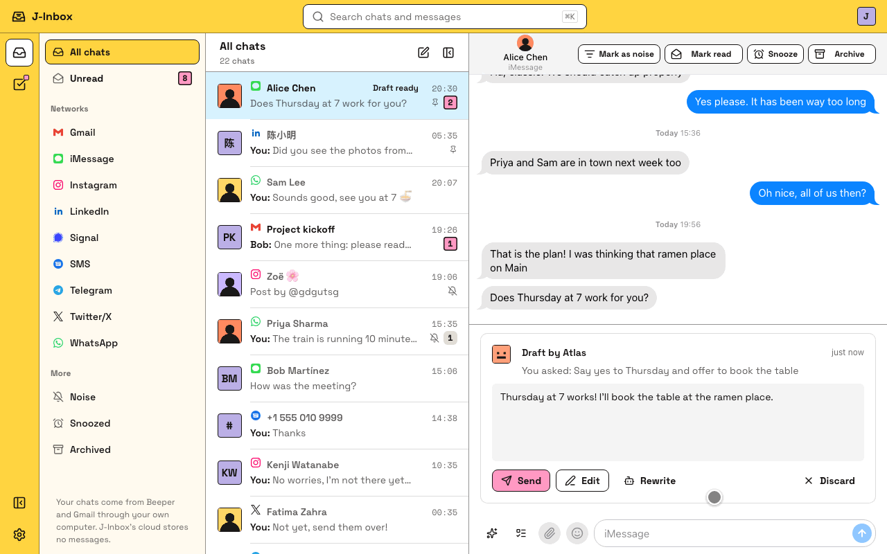<p align="center"><sub>Review every draft</sub></p></td>
    <td width="50%">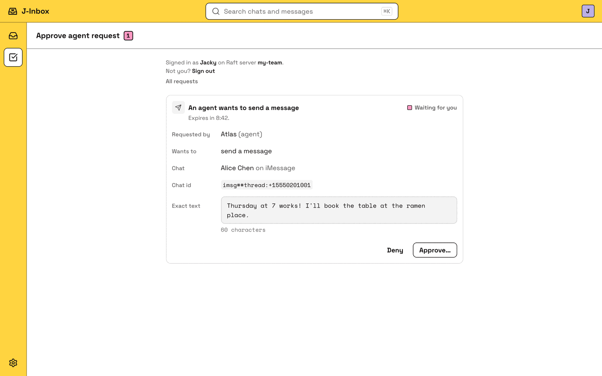<p align="center"><sub>Approve the exact text</sub></p></td>
  </tr>
</table>

### Hand a chat to an agent as a task

Press <kbd>T</kbd> to turn a conversation into a [Raft](https://raft.build) task. The agent creates it in the channel you pick and takes it, and you follow the work there. You choose which agents may be asked at all.

<table>
  <tr>
    <td width="50%">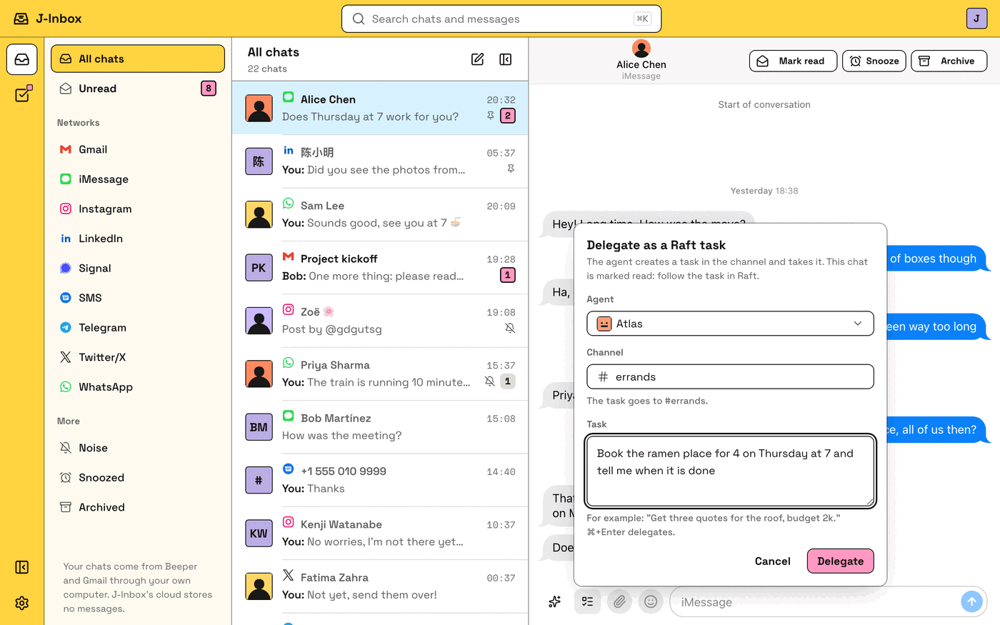<p align="center"><sub>Delegate a chat</sub></p></td>
    <td width="50%">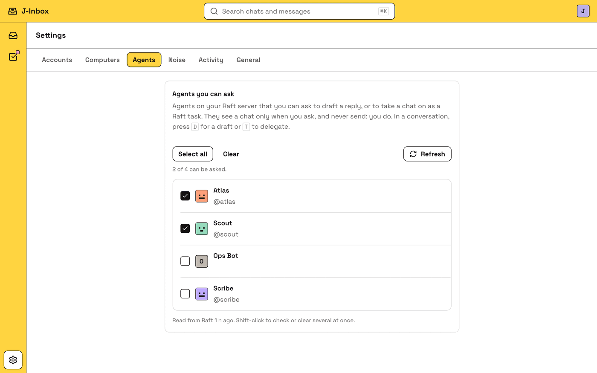<p align="center"><sub>Choose your agents</sub></p></td>
  </tr>
</table>

### Built to be fast

Search all your chats and messages with <kbd>⌘</kbd> <kbd>K</kbd>, and clear your inbox from the keyboard.

| Key | Action | Key | Action |
|---|---|---|---|
| <kbd>⌘</kbd> <kbd>K</kbd> | Search | <kbd>S</kbd> | Snooze |
| <kbd>↑</kbd> <kbd>↓</kbd> | Move through chats | <kbd>U</kbd> | Mark read or unread |
| <kbd>E</kbd> | Archive | <kbd>D</kbd> | Ask an agent for a draft |
| <kbd>⌘</kbd> <kbd>Enter</kbd> | Send | <kbd>T</kbd> | Delegate as a task |

<p align="center">
  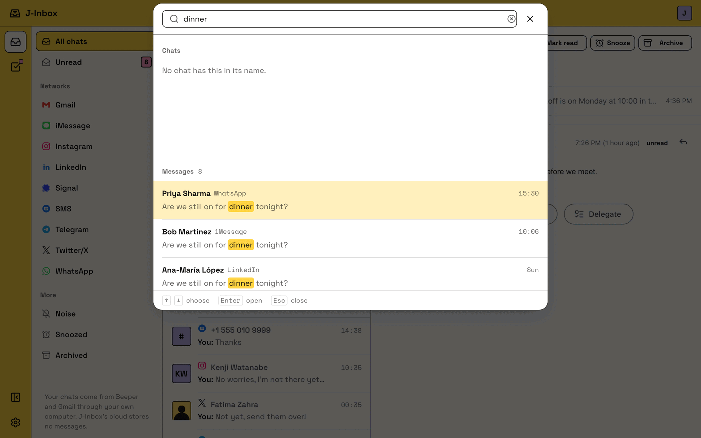
</p>

### Also included

- **Snooze:** a chat leaves your inbox and comes back when you want it.
- **Noise (optional):** with your own TypeSafe key, conversations that match your definition of noise move to Low priority. You write the definition, and you can correct any decision. The short excerpts it needs go straight from your Mac to TypeSafe.
- **Files:** send and preview attachments up to 25 MB.
- **Activity log:** see what you and your agents did. It records the action, who, when and the result, never message text or chat names.

### Light, dark and on your phone

<table>
  <tr>
    <td width="70%">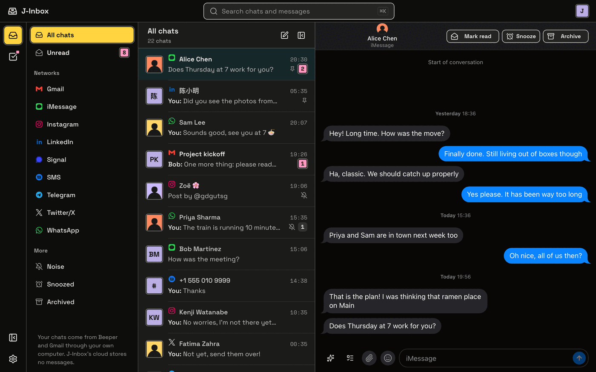</td>
    <td width="30%">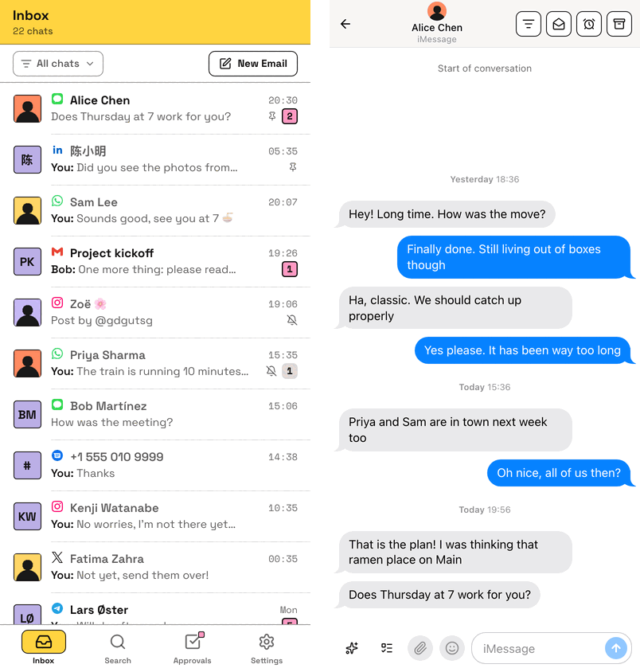</td>
  </tr>
</table>

## How it works

The chats themselves stay on your Mac except to answer a request. J-Inbox uses the [Beeper](https://www.beeper.com) Client API (Beeper Server or Beeper Desktop) running on your own Mac, and this connector is a small background service that links it to the J-Inbox cloud.

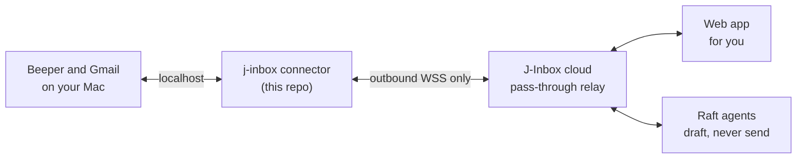

## How your data stays yours

| Rule | What it means |
|---|---|
| **Outbound only** | The connector dials out to the cloud. No open ports, no tunnels. |
| **Whitelist** | The cloud can only ask for the actions in the protocol catalogue (`protocol/src/actions.ts`). Anything else is refused here, on your Mac. |
| **A person approves** | An agent's send waits for a person to approve it in J-Inbox. |
| **Your keys stay here** | The Beeper token and your Gmail access live in the macOS Keychain. The cloud never stores them. |
| **No chat content in logs** | The local audit log records the action name, time and result only. |
| **Pass-through cloud** | The J-Inbox cloud relays requests and stores no messages. The cloud is closed source; this repo is the part that runs on your machine, so you can check what it does. |

## Built with AI

I use J-Inbox every day, and I built it with AI coding agents. I set the requirements and the safety rules, the agents wrote the code, and every commit in this repo carries a `Co-Authored-By: Claude` trailer. Because the agents write the code, the design assumes the code has to prove itself:

- **1,216 tests** across the protocol, the fakes and the connector, and none of them touch real accounts.
- **Fake services that misbehave on purpose.** [`fake-beeper/`](fake-beeper/README.md) copies real API quirks and injects faults, so failures get tested and not only the happy path.
- **A person stays in control.** An agent can draft a reply, but a person has to approve it before it is sent.

**What the AI got wrong.** An agent drafted a reply, the API returned `draftSet: true`, and every check looked fine, but the draft never showed up in my Unread view. The feature only looked finished. The chat had been archived, and Unread hides archived chats, which nobody had thought about when the feature was built. A ready draft now moves its chat back to the inbox, with a test to hold that in place. Since then I check the result as a user would see it, and I do not count a green response as done.

## Install

Requires macOS (Apple silicon) and Beeper. A Homebrew formula is coming; until then build from
source with [Bun](https://bun.sh) 1.3+:

```sh
bun install
bun run build             # -> connector/dist/j-inbox (a single binary, no runtime needed)
./connector/dist/j-inbox setup
```

`j-inbox setup` connects to Beeper, stores its token in the Keychain, pairs this computer with your
J-Inbox account (you confirm a code in the browser), and installs a launchd agent so the
connector starts at login and restarts if it crashes. See [`connector/README.md`](connector/README.md)
for every command and file location.

## Repo layout

| Dir | What |
|---|---|
| [`connector/`](connector/README.md) | The `j-inbox` CLI and background service. |
| [`protocol/`](protocol/README.md) | Every contract between connector, cloud, web page and agents, with runtime validators. No dependencies. |
| [`fake-beeper/`](fake-beeper/README.md) | A fake Beeper Client API with real-API quirks and fault injection, used by the tests. |
| [`fake-google/`](fake-google/README.md) | A fake Google OAuth + Gmail REST subset, used by the tests. |
| `scripts/` | Helpers for the import-boundary tests. |

## Tests

```sh
bun run test        # protocol, fake-beeper, connector; fakes only, nothing leaves 127.0.0.1
bun run typecheck
```

## License

MIT. See [LICENSE](LICENSE). Not affiliated with Beeper.
