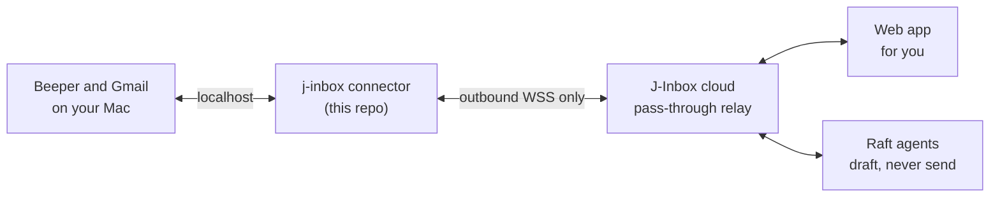

<p align="center">
  
</p>

<p align="center">
  <a href="https://inbox.jackyzhonghq.com"><b>Website</b></a> &nbsp;·&nbsp;
  <a href="#why-j-inbox"><b>Why J-Inbox</b></a> &nbsp;·&nbsp;
  <a href="#architecture"><b>Architecture</b></a> &nbsp;·&nbsp;
  <a href="#install"><b>Install</b></a> &nbsp;·&nbsp;
  <a href="#built-with-ai"><b>Built with AI</b></a>
</p>

<p align="center">
  
  
  
  
  
</p>

J-Inbox puts WhatsApp, iMessage, Instagram, LinkedIn, X, Telegram, Signal, SMS and Gmail in one fast inbox. AI agents can draft your replies and take on tasks, but **nothing is sent until a person approves it**.

This repo is the open-source half: the connector that runs on your Mac.

<p align="center">
  
</p>
<p align="center"><sub>Every name and message in these images is invented demo data.</sub></p>

## Why J-Inbox

### Every chat in one place

One list for all your networks, while each conversation still feels like its own app.

<table>
  <tr>
    <td width="33%"></td>
    <td width="33%"></td>
    <td width="33%"></td>
  </tr>
</table>

### Agents help, you stay in control

Ask an agent to draft a reply or hand it a chat as a task. You see the exact text before anything goes out.

<table>
  <tr>
    <td width="50%"></td>
    <td width="50%"></td>
  </tr>
</table>

### Your chats stay on your Mac

The connector only dials out, your keys stay in the macOS Keychain, and the cloud relays requests without storing messages. The part on your machine is open source, so you can check it.

### Works everywhere

Light, dark, desktop and phone.

<table>
  <tr>
    <td width="70%"></td>
    <td width="30%"></td>
  </tr>
</table>

## Architecture



| Part | Built with | Role |
|---|---|---|
| **Connector** (open source) | TypeScript, Bun | Runs on your Mac and only performs a whitelist of actions |
| **Protocol** (open source) | TypeScript | One shared contract for every part, checked at runtime |
| **Cloud** | Cloudflare | Relays requests and stores no messages |
| **Web app** | React, Tailwind CSS | The inbox you use, on desktop and phone |
| **Agents** | [Raft](https://raft.build) App | Lets agents draft replies and take on tasks |

## Built with AI

I use J-Inbox every day, and I built it with AI coding agents. I set the requirements and the safety rules, the agents wrote the code, and every commit in this repo carries a `Co-Authored-By: Claude` trailer. Because the agents write the code, the design assumes the code has to prove itself:

- **1,216 tests** across the protocol, the fakes and the connector, and none of them touch real accounts.
- **Fake services that misbehave on purpose.** [`fake-beeper/`](fake-beeper/README.md) copies real API quirks and injects faults, so failures get tested and not only the happy path.
- **A person stays in control.** An agent can draft a reply, but a person has to approve it before it is sent.

**What the AI got wrong.** An agent drafted a reply, the API returned `draftSet: true`, and every check looked fine, but the draft never showed up in my Unread view. The feature only looked finished. The chat had been archived, and Unread hides archived chats, which nobody had thought about when the feature was built. A ready draft now moves its chat back to the inbox, with a test to hold that in place. Since then I check the result as a user would see it, and I do not count a green response as done.

## Install

Requires macOS (Apple silicon), [Beeper](https://www.beeper.com) and [Bun](https://bun.sh) 1.3+.

```sh
bun install
bun run build
./connector/dist/j-inbox setup
```

See [`connector/README.md`](connector/README.md) for details.

## License

MIT. See [LICENSE](LICENSE). Not affiliated with Beeper.
